## Setup

- [nixos](https://github.com/noahhhx/nixos): my NixOS config, a dendritic flake
- [pi-shop](https://github.com/noahhhx/pi-shop): my pi coding-agent setup, with skills, extensions and AGENTS.md
- [site](https://github.com/noahhhx/site): source for [noahhh.co.uk](https://noahhh.co.uk), built with Leptos and Axum

## Personal software

- [bounce](https://github.com/noahhhx/bounce): self-hosted, whole-home audio broadcasting
- [mimos](https://github.com/noahhhx/mimos): self-hostable recipes, meal planning and shopping lists
- [eoscam](https://github.com/noahhhx/eoscam): use a Canon EOS camera as a Linux webcam
- [powr](https://github.com/noahhhx/powr): minimal power menu for Hyprland
- [jauth](https://github.com/noahhhx/jauth): Cisco AnyConnect SAML login for openconnect
- [usb-hid-relay](https://github.com/noahhhx/usb-hid-relay): relay mouse events over UDP to a Raspberry Pi acting as a USB HID device

---

<a href="https://noahhh.co.uk">noahhh.co.uk</a> · <a href="https://github.com/noahhhx/site">source</a>

